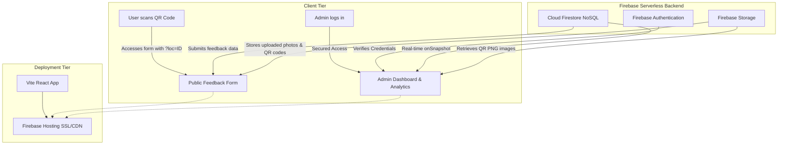

# Project Presentation Documentation & Slide Outline

## System: Online Feedback & Suggestion System for Cafeteria at TVET MARA Besut
**Academic Scope:** Diploma in Computer Technology (Cloud Computing) — IKM Besut
**Project Status:** Production Handoff Ready
**File Path:** `PROJECT_PRESENTATION_DOCUMENTATION.md`

---

# Part 1: Detailed Technical & Product Documentation

## 1. Introduction & Background
The **Online Feedback and Suggestion System** is a cloud-native web application designed to collect, manage, and analyze customer feedback and service complaints for the cafeteria at **TVET MARA Besut (IKM Besut)**. 

In institutional environments like TVET MARA Besut, cafeteria quality directly affects the health, satisfaction, and well-being of students, staff, and visitors. The system modernizes feedback submission by placing location-specific **QR codes** at tables, service counters, and facility blocks. Users can scan these codes with their smartphones to access a web-based form immediately—eliminating the need to download separate mobile applications. Admins can track, prioritize, resolve issues, and view interactive performance reports from a secure web portal.

---

## 2. Problem Statement
Traditional feedback collection methods suffer from significant inefficiencies:

*   **Scattered and Misplaced Feedback:** Physical suggestion boxes and unstructured email complaints lead to lost forms, poor record-keeping, and no centralized history.
*   **No Progress Tracking:** Submitting customers do not know if their complaints are received, under review, or resolved. This transparency gap lowers trust.
*   **Response Bottlenecks:** Without an automated prioritization system, urgent issues (such as water leaks, hygiene hazards, or safety concerns) are treated with the same urgency as minor suggestions, delaying remediation.
*   **Zero Trend Analysis:** Administrators cannot analyze patterns over time (e.g., identifying recurring food quality complaints, unclean tables, or slow service at particular counters) because they lack structured data visualizations.

---

## 3. Project Objectives
The system was designed and developed to achieve the following core objectives:
1.  **Simplify Feedback Submission:** Provide a lightweight, mobile-responsive web form accessible via QR codes without registration.
2.  **Ensure Transparency:** Enable unique tracking IDs (Reference IDs) for feedbacks, allowing admins to update status (`New` $\rightarrow$ `Under Review` $\rightarrow$ `Resolved`) and write action notes.
3.  **Real-Time Monitoring:** Implement instantaneous update feeds for administrators to identify and respond to high-priority complaints without page refreshes.
4.  **Data-Driven Decisions:** Generate automated charts (categories, status distributions, monthly trends, and location-based complaints) to support cafeteria management decisions.
5.  **Inclusive Design:** Support bilingual toggles (English and Bahasa Melayu) and theme toggles (Dark and Light mode) to ensure usability for all students, staff, and administrators.

---

## 4. System Architecture & Cloud-Native Tech Stack
The project is built on a modern **Serverless/Cloud-Native Architecture**, eliminating the cost and overhead of maintaining dedicated server infrastructure.



### Technical Component Breakdown
*   **Frontend Framework:** React 19 (Vite) – Selected for its rendering speed, modular component-based structure, and modern developer experience.
*   **Styling Engine:** Tailwind CSS v4 – Utilized to create a premium, mobile-responsive interface featuring customizable themes and micro-animations.
*   **Database (NoSQL):** Cloud Firestore – A scalable, real-time database that pushes immediate database state modifications to connected admin clients using native socket subscriptions (`onSnapshot`).
*   **Authentication:** Firebase Auth – Restricts dashboard access strictly to authorized administrator accounts.
*   **Cloud Storage:** Firebase Storage – Securely stores user-submitted images (JPEG, PNG up to 5MB) and auto-generated QR code templates.
*   **Bilingual Framework:** `i18next` & `react-i18next` – Manages translation sets dynamically inside JSON locales without page reloads.
*   **Data Visualization:** Recharts – Renders SVG-based charts directly on the frontend, parsing live Firestore datasets into interactive category bars, status pies, and monthly trend lines.
*   **QR Code Generator:** `qrcode` npm library – Generates location-based feedback URLs dynamically at runtime, allowing admins to download print-ready PNG codes.

---

## 5. Database Schema (Firestore NoSQL)

Cloud Firestore stores data inside collections containing JSON-like documents:

### A. Collection: `feedback`
Stores all user suggestions and issue reports.
```json
{
  "id": "String (Generated UUID)",
  "category": "String (Makanan | Kebersihan | Kemudahan | Perkhidmatan | Umum)",
  "priority": "String (low | medium | high)",
  "description": "String (Detailed text, maximum 500 characters)",
  "photoUrl": "String | null (Firebase Storage URL of the attached image)",
  "location": "String | null (Manual text entry fallback)",
  "locationId": "String | null (Foreign Key mapping to locations.id)",
  "status": "String (new | under_review | resolved)",
  "submittedAt": "Timestamp (Server generated creation time)",
  "updatedAt": "Timestamp (Server generated modification time)",
  "adminNotes": "String | null (Actions taken / notes added by administrator)",
  "isAnonymous": "Boolean (True if submitter chose to hide details)"
}
```

### B. Collection: `locations`
Stores physical points inside the TVET cafeteria linked to unique QR codes.
```json
{
  "id": "String (Sanitized slug, e.g., 'table-5', 'drinks-counter')",
  "name": "String (Display name, e.g., 'Table 5', 'Drinks Counter')",
  "qrCodeUrl": "String (Storage download link of generated QR image)",
  "active": "Boolean (Determines if the QR code is active and accepting submissions)",
  "createdAt": "Timestamp (Creation server time)"
}
```

### C. Collection: `admins`
Stores roles and permissions of authorized administrative staff.
```json
{
  "uid": "String (Firebase Authentication User UID)",
  "name": "String (Administrator Name)",
  "email": "String (Authorized Login Email)",
  "role": "String (admin | superadmin)"
}
```

---

## 6. Key System Workflows

### A. Feedback Submission Workflow
1.  **Scan QR Code:** A user scans a physical QR code (placed at a cafeteria table or counter) using their smartphone camera.
2.  **Open Form URL:** The browser opens the web form with a query parameter pointing to the location's ID (e.g., `?loc=table-5`).
3.  **Pre-fill Location:** The application fetches the active location's display name from Firestore (e.g. "Table 5") and locks it on the form.
4.  **Complete and Submit:** The user selects a category (Food, Cleanliness, Facilities, Service, General), writes the complaint, attaches an optional image, and clicks submit.
5.  **Validation and Storage:** The frontend validates the input (under 500 characters). If a photo is attached, it uploads the file to Firebase Storage.
6.  **Create Record:** The application writes a new document to the Firestore `feedback` collection with a status of `new` and returns a reference ID.

### B. Location & QR Management Workflow
1.  **Add Location:** An administrator navigates to the "Manage Locations" tab and inputs the location name and a slug (e.g., "Counter A", `counter-a`).
2.  **Generate QR Image:** The client-side library `qrcode` generates a Base64-encoded QR image pointing to `https://[domain]/aduan?loc=counter-a`.
3.  **Upload to Storage:** The image file is converted into a Blob and uploaded to Firebase Storage under `qr_codes/counter-a.png`.
4.  **Save to Firestore:** A new location record is written in Firestore containing the storage download URL.
5.  **Print and Deploy:** The administrator downloads the PNG image to print and place at the physical location.

---

## 7. Quality Assurance & Verification
To ensure high stability, security, and performance, the system went through rigorous testing:
*   **Validation Testing:** Unit tests in `src/utils.test.js` verify that user descriptions are not empty, correctly trimmed, and reject strings exceeding 500 characters.
*   **Firestore Rules Enforcement:** Firestore Security Rules verify that public users can only call `create` operations on `feedback` and cannot read other submissions. Admin routes and write privileges are restricted via `request.auth != null`.
*   **User Acceptance Testing (UAT) Checklist:**
    1.  *QR Scan Test:* QR scanning correctly extracts parameters and locks the location field.
    2.  *File Upload Test:* Pictures over 5MB are blocked, and images are successfully uploaded to Storage.
    3.  *Translation & State Sync:* Language and Dark Mode toggles update dynamically and preserve preferences across tabs and refreshes using `localStorage`.
    4.  *Real-time Feed Test:* Placing new mock submissions immediately raises visual alert banners in the admin panel without reloading.

---
---

# Part 2: Slide-by-Slide Presentation Structure

This outline is ready to be directly copy-pasted or adapted into slides (using Microsoft PowerPoint, Google Slides, or Canva).

### **Slide 1: Title Slide**
*   **Slide Title:** Online Feedback & Suggestion System
*   **Subtitle:** A Cloud-Native, Location-Aware QR Feedback Platform for TVET MARA Besut Cafeteria
*   **Presenter Name:** [Your Name]
*   **Course Details:** Diploma in Computer Technology (Cloud Computing), IKM Besut
*   **Lecturer Name:** [Lecturer's Name]
*   **Visual:** Mockup showing a phone scanning a QR code next to a laptop displaying the admin analytic dashboard.

---

### **Slide 2: Background & Project Origin**
*   **Slide Title:** Introduction & Context
*   **Content:**
    *   Developed for the cafeteria at TVET MARA Besut (IKM Besut) to streamline and digitize customer satisfaction feedback.
    *   Replaces physical feedback papers and scattered emails that are hard to compile.
    *   Optimized for smartphones, ensuring fast, frictionless, on-the-spot submissions.
    *   Designed as a cloud-native project to demonstrate key cloud concepts: serverless execution, real-time reactive databases, and automated CDN hosting.

---

### **Slide 3: Problem Statement**
*   **Slide Title:** The Challenges of Manual Feedback
*   **Content:**
    *   **Feedback Loss:** Manual slips get misplaced, lost, or damaged.
    *   **No Customer Transparency:** Submitter has no way of knowing if their feedback has been read, worked on, or resolved.
    *   **Priority Bottlenecks:** Urgent facility, safety, or health concerns (e.g. food poisoning risks, gas leaks) are hidden inside bulk routine comments.
    *   **Decision-Making Obstacles:** Management has no visual analytics to identify poor service lines, recurring issues, or location-based problem clusters.

---

### **Slide 4: Project Objectives**
*   **Slide Title:** What We Aimed to Achieve
*   **Content:**
    *   Deploy a **mobile-responsive feedback form** accessible via location QR codes.
    *   Provide **automatic location tracking** through QR URL routing parameters.
    *   Establish a **real-time dashboard** for managers to monitor feed updates instantly.
    *   Incorporate **status tracking** (`New` $\rightarrow$ `Under Review` $\rightarrow$ `Resolved`) to close the feedback loop.
    *   Embed **interactive visual analytics** (Recharts) to highlight issue trends, locations, and categories.
    *   Support accessibility through **bilingual translations** and **dark mode**.

---

### **Slide 5: Cloud-Native Architecture**
*   **Slide Title:** Tech Stack & Architecture
*   **Content:**
    *   **Frontend UI:** React 19 (Vite) + Tailwind CSS v4.
    *   **NoSQL Database:** Cloud Firestore (Live sync via sockets).
    *   **Admin Security:** Firebase Authentication.
    *   **Cloud Assets Storage:** Firebase Storage (For user uploads & QR code images).
    *   **Application Delivery:** Firebase Hosting (Fast, SSL-secured CDN edge loading).
    *   **Dynamic Localization:** i18next engine.
    *   **Data Charts:** Recharts SVG rendering.

---

### **Slide 6: Database Design (NoSQL Firestore)**
*   **Slide Title:** Firestore Collection Schemes
*   **Content:**
    *   **`feedback` collection:** Tracks category, description, status, submittedAt, photoUrl, adminNotes, priority, locationId, isAnonymous.
    *   **`locations` collection:** Tracks name, sanitised slug ID (used in QR param), active flag, and qrCodeUrl.
    *   **`admins` collection:** Tracks authenticated administrator UIDs, emails, roles, and names.
    *   **Security Rules:** Standard users can only write to `feedback`; admin directories are locked via authentication queries.

---

### **Slide 7: Core Feature 1: Location QR Form Routing**
*   **Slide Title:** Dynamic QR Feedback Linkage
*   **Content:**
    *   Admins generate physical QR codes for cafeteria points (e.g., "Counter A", "Table 5").
    *   Scanning the code launches: `https://[app-url]/aduan?loc=counter-a`.
    *   The app reads `loc` parameter and pre-fills the location info automatically, ensuring exact, localized tracking.
    *   Fallback input field is rendered if accessed directly without scanning a QR.

---

### **Slide 8: Core Feature 2: Admin Dashboard**
*   **Slide Title:** Real-Time Incident Management
*   **Content:**
    *   Secure admin portal showing lists of incoming issues with customizable status flags.
    *   **Real-time Alerts:** The dashboard displays a notification badge/banner instantly upon receiving new high-priority submissions.
    *   **Detail Drawer:** Admins can click on cards to inspect description texts, download uploaded photos, update status, shift category/priority, and write actions inside *Admin Action Notes*.

---

### **Slide 9: Core Feature 3: Analytical Reports**
*   **Slide Title:** Interactive Charts (Recharts)
*   **Content:**
    *   **Category Analysis (Bar Chart):** Shows the count of feedbacks across Food, Cleanliness, Service, Facilities, and General.
    *   **Status Ratios (Pie Chart):** Shows distribution of New, Under Review, and Resolved cases.
    *   **Monthly Trend (Line Chart):** Maps the feedback rate over months.
    *   **Location Breakdown (Bar Chart):** Pinpoints physical areas accumulating the most complaints.

---

### **Slide 10: Core Feature 4: Theme Toggle & Language Toggle**
*   **Slide Title:** Universal Usability & Custom UX
*   **Content:**
    *   **Dynamic Translation Toggle:** Switch between English and Bahasa Melayu seamlessly. Handles forms, statuses, and charts.
    *   **Adaptive Dark Theme Toggle:** Integrates Tailwind class variants, matches system preferences, and saves setup via `localStorage` for visual consistency.
    *   **Mobile-First Responsive Layout:** Designed specifically to fit mobile views, tablets, and desktop displays.

---

### **Slide 11: System Verification & Security**
*   **Slide Title:** Testing and Quality Verification
*   **Content:**
    *   **Code Validation:** Client-side validator checks character constraints (<500 characters) and prevents empty forms.
    *   **Security Controls:** Firestore Security Rules block public read requests on the `feedback` collection, safeguarding user privacy.
    *   **UAT Checklists Completed:**
        *   File upload size checking (blocks >5MB).
        *   Offline theme/translation persistence.
        *   Instant, live database update feeds on the Admin screen.

---

### **Slide 12: Future Roadmap**
*   **Slide Title:** Next Phases & Improvements
*   **Content:**
    *   **Notification Extensions:** Integrate SMS/WhatsApp API for instant alerts to cafeteria staff.
    *   **AI Sentiment Tagging:** Analyze descriptions automatically to score urgency based on text emotion.
    *   **Super-Admin Panels:** Control role settings and account registrations directly inside the app.

---

### **Slide 13: Summary & Conclusion**
*   **Slide Title:** Conclusion
*   **Content:**
    *   Modernized IKM Besut Cafeteria feedback system into a reactive, cloud-native application.
    *   Replaces physical bottlenecks with dynamic QR codes and status tracking.
    *   Lowers operational maintenance costs by using serverless backend systems.
    *   Successfully applies Cloud Technology, React Single-Page Application concepts, and NoSQL databases.
*   **Q&A Session — Thank you!**
